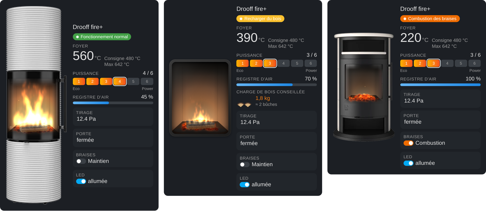

# Drooff fire+ V2 pour Home Assistant

[](https://www.home-assistant.io/integrations/marketplace/)
[](https://www.home-assistant.io/)
[](https://github.com/steigerbalett/ha-drooff-fireplus-v2/releases)
[](https://github.com/steigerbalett/ha-drooff-fireplus-v2/releases)
[](https://github.com/steigerbalett/ha-drooff-fireplus-v2/releases/latest)
[](https://github.com/steigerbalett/ha-drooff-fireplus-v2/actions/workflows/validate.yml)
[](LICENSE)

[English](README.md) | [Deutsch](README.de.md) | **Français**

Une intégration personnalisée pour [Home Assistant](https://www.home-assistant.io/) destinée à la régulation de combustion [Drooff fire+](https://www.drooff-kaminofen.de/en/nature/electronic-combustion-control-fire/), avec sa propre carte de tableau de bord, un blueprint de rappel pour recharger du bois et des statistiques sur chaque feu.



<sub>À gauche et à droite avec les images fournies du BRUNELLO 2 L Groove (StilBeton cream) et du VARESE 3 (PremiumWhite), au milieu le foyer dessiné. Images © DROOFF Kaminöfen GmbH & Co. KG, voir [NOTICE.md](NOTICE.md).</sub>

## Origine et remerciements

L'idée et la base de cette intégration viennent de **Thorsten Ehlers ([@tehlers](https://github.com/tehlers))** et de son projet [ha-drooff-fireplus](https://github.com/tehlers/ha-drooff-fireplus). Il a découvert comment l'application web du fire+ communique avec le poêle, a créé l'intégration et l'a maintenue avec l'aide de ses contributeurs. Sans tout ce travail préparatoire, ce fork et la version 2 n'existeraient pas. Un grand merci !

Drooff fire+ V2 poursuit ce travail en tant que projet indépendant, car les extensions sont devenues trop importantes pour le dépôt d'origine. Merci de signaler les problèmes de la V2 [ici](https://github.com/steigerbalett/ha-drooff-fireplus-v2/issues) et non au projet d'origine.

### Merci à Drooff

Un grand merci à **DROOFF Kaminöfen GmbH & Co. KG**, qui autorise aimablement ce projet à utiliser le logo Drooff et les photos des poêles. Ainsi, l'intégration s'intègre parfaitement à Home Assistant et à la carte de tableau de bord.

## Nouveautés de la version 2

- **Carte de tableau de bord** avec un feu animé, des commandes, l'image de votre poêle (83 photos de produits Drooff au choix), une jauge de tirage, des graphiques d'historique et une zone d'alerte qui n'apparaît qu'en cas de problème
- **Blueprint « Ajouter du bois »** avec des messages (Pushover, Telegram, application mobile, …), des annonces sur Echo et toute autre action, chacune avec son propre délai
- **Statistiques** issues du journal d'événements du fire+ : feux, rechargements, consommation de bois estimée, dernier rechargement
- **Verrouillages de commande** comme dans l'application web (télécommande, thermostat d'ambiance, panneau), poêles Ange bleu avec Eco et Power uniquement
- Nouveaux capteurs : porte ouverte trop longtemps, filtre à particules (Ange bleu), commande, état des mises à jour, réglages de l'application web
- En allemand, en anglais et en français : intégration, textes du blueprint et carte de tableau de bord (la carte aussi en néerlandais, italien, polonais, tchèque et danois)
- Découverte via DHCP, états de fonctionnement traduits, téléchargement des diagnostics, tests pour toutes les fonctions

La liste complète des modifications se trouve dans le [journal des modifications](CHANGELOG.md) (en anglais).

## Installation

### Marketplace (Home Assistant 2026.11 et plus récent)

Depuis Home Assistant 2026.11, HACS fait partie de Home Assistant sous le nom de [Marketplace](https://www.home-assistant.io/integrations/marketplace/). Drooff fire+ V2 figure dans son catalogue communautaire (les anciens dépôts par défaut de HACS), aucun dépôt personnalisé n'est donc nécessaire.

1. Ouvrez *Paramètres*, *Marketplace* en tant qu'administrateur.
2. Recherchez « Drooff fire+ V2 » et sélectionnez *Installer*. La configuration démarre aussitôt (voir *Configuration*).

### HACS (Home Assistant 2026.3.1 à 2026.10)

1. Assurez-vous que [HACS](https://hacs.xyz) est installé.
2. Recherchez « Drooff fire+ V2 » dans HACS et téléchargez-le.
3. Redémarrez Home Assistant.

Le bouton ouvre l'intégration dans le Marketplace ou dans HACS :

[](https://my.home-assistant.io/redirect/hacs_repository/?owner=steigerbalett&repository=ha-drooff-fireplus-v2&category=integration)

### Installation manuelle

1. Téléchargez `drooff_fireplus_v2.zip` depuis la [dernière version](https://github.com/steigerbalett/ha-drooff-fireplus-v2/releases/latest).
2. Décompressez-le dans `custom_components/drooff_fireplus_v2` du répertoire `config` de votre Home Assistant.
3. Redémarrez Home Assistant.

### Passer de la V1 à la V2

La V1 est l'intégration *Drooff fire+* (`drooff_fireplus`) de [tehlers/ha-drooff-fireplus](https://github.com/tehlers/ha-drooff-fireplus). La V2 a son propre domaine `drooff_fireplus_v2`. Elle peut être installée à côté de la V1, mais les deux interrogeraient alors le même fire+. Pour changer :

1. Sous *Paramètres*, *Appareils et services*, supprimez l'intégration V1 *Drooff fire+*. Faites-le **en premier**, afin que les nouvelles entités reçoivent les mêmes identifiants d'entité qu'avant.
2. Désinstallez la V1 (*Drooff fire+*) dans le Marketplace ou dans HACS.
3. Installez la V2 comme décrit ci-dessus et configurez-la (voir *Configuration*). Avec HACS, redémarrez Home Assistant avant la configuration.

Ce qui est conservé : Home Assistant conserve l'historique et les statistiques à long terme par identifiant d'entité ; avec les mêmes identifiants, vos graphiques continuent donc. Les tableaux de bord et automatisations qui utilisent ces identifiants continuent de fonctionner. Vérifiez les identifiants d'entité après la configuration ; un identifiant qui se termine par `_2` signifie qu'une ancienne entité existait encore.

Ce qui n'est pas conservé : les réglages modifiés dans les options de l'intégration (intervalle d'interrogation, IPv4), les entités activées, désactivées ou renommées à la main, et l'identifiant d'appareil utilisé par les déclencheurs d'appareil. Les statistiques de l'intégration (feux, rechargements, bois) repartent des événements encore enregistrés sur le fire+.

**Changement incompatible :** l'état de fonctionnement a désormais des états en minuscules (`wood_required` au lieu de `WOOD_REQUIRED`, …). Adaptez vos propres automatisations, scripts et modèles. Les automatisations créées à partir du blueprint de la V1 doivent être recréées à partir du blueprint de la V2 *Drooff fire+: Holz nachlegen / Add wood*.

## Configuration

1. Allez dans *Paramètres* > *Appareils et services* > *Ajouter une intégration*.
2. Recherchez « Drooff fire+ V2 » et sélectionnez-le.
3. Saisissez le nom d'hôte de l'application web de votre Drooff fire+. Dans la configuration par défaut, il s'agit de « fire ».

[](https://my.home-assistant.io/redirect/config_flow_start/?domain=drooff_fireplus_v2)

Si le fire+ garde son nom d'hôte par défaut « fire », Home Assistant le découvre généralement automatiquement (DHCP) et propose de le configurer sous *Appareils et services*. Les majuscules et minuscules n'ont pas d'importance, un fire+ qui s'annonce comme « FIRE » est également trouvé. Un fire+ déjà configuré n'est pas proposé à nouveau. Si le fire+ a été configuré avec son adresse IP, un changement d'adresse IP est pris en compte automatiquement.

Les diagnostics (valeurs analysées et réponses brutes du fire+, sans l'hôte ni le numéro de série) peuvent être téléchargés sur la page de l'appareil pour les rapports de bogue.

## Entités

Les noms des entités suivent la langue de Home Assistant. Les tableaux indiquent les noms français.

### Commandes

| Nom                         | Type   | Description                                              |
| --------------------------- | ------ | -------------------------------------------------------- |
| `Puissance de combustion`   | Number | Choix de la puissance de combustion en six niveaux entre « Eco » et « Power » (uniquement « Eco » et « Power » pour les poêles labellisés Ange bleu) |
| `Combustion des braises`    | Switch | Bascule entre « Maintien des braises » et « Combustion des braises » |
| `LED`                       | Switch | Allume ou éteint la LED (uniquement Drooff fire+ v1)     |

Comme l'application web du fire+, l'intégration refuse les modifications tant que le fire+ n'est pas commandé par le web : avec une télécommande, tous les réglages sont verrouillés ; avec un thermostat d'ambiance ou lorsque le panneau du poêle est sélectionné, la puissance de combustion est verrouillée. Voir `Commande` ci-dessous.

### Capteurs

| Nom                            | Type   | Description                                                   |
| ------------------------------ | ------ | ------------------------------------------------------------- |
| `Position du registre d'air`   | Sensor | Position du registre d'air en pour cent                       |
| `Tirage`                       | Sensor | Tirage de la cheminée en Pa                                   |
| `Progression de l'allumage`    | Sensor | Progression de l'allumage en pour cent (uniquement pendant `heating`) |
| `État de fonctionnement`       | Sensor | État de fonctionnement du poêle, affiché dans la langue de Home Assistant. Les états (pour les automatisations) sont :<br>- `standby`<br>- `regular`<br>- `heating`<br>- `wood_required`<br>- `wood_urgently_required`<br>- `ember_preservation`<br>- `ember_burndown`<br>- `error`<br>- `unknown`<br><br>Jusqu'à la version 1.5, les états étaient en majuscules (`REGULAR`, …). Les automatisations et scripts qui les comparent doivent être adaptés aux états en minuscules. |
| `Température`                  | Sensor | Température dans la chambre de combustion en °C               |
| `Température cible`            | Sensor | Température cible dans la chambre de combustion en °C         |
| `Charge de bois recommandée`   | Sensor | Quantité de bois recommandée à ajouter en kg (uniquement les appareils récents) |
| `Porte`                        | Sensor | Indicateur du contact de porte                                |
| `Porte ouverte trop longtemps` | Binary Sensor | Problème lorsque la porte est ouverte plus de 5 minutes alors que la température dépasse 40 °C, comme l'avertissement de l'application web (uniquement les appareils récents) |
| `État du filtre`               | Sensor | État du filtre à particules OekoSolve : `driver_error`, `not_found`, `present`, `inactive`, `active`, `cleaning_required` ou `error` (uniquement les poêles labellisés Ange bleu) |
| `Problème de filtre`           | Binary Sensor | Problème lorsque l'application web affiche l'état du filtre en rouge : erreur du pilote, filtre introuvable, nettoyage nécessaire ou autre erreur (uniquement les poêles labellisés Ange bleu) |

### Statistiques

L'intégration lit le journal d'événements du fire+ (ouvertures de porte et phases, `php/easevents.php`) une fois par minute et conserve les compteurs lors des redémarrages. Ils sont `total_increasing`, la carte de graphique de statistiques ou un compteur de services (utility meter) les affiche donc par jour, semaine ou mois.

| Nom                               | Type   | Description |
| --------------------------------- | ------ | ----------- |
| `Feux`                            | Sensor | Feux : un allumage suivi d'un fonctionnement normal (un allumage qui se termine en veille n'est pas compté) |
| `Rechargements`                   | Sensor | Ouvertures de porte pendant le fonctionnement normal ; les ouvertures à moins de 10 minutes d'intervalle comptent une seule fois |
| `Consommation de bois (estimée)`  | Sensor | Charge de bois recommandée à chaque feu et rechargement, en kg. Il s'agit d'une estimation, le fire+ ne pèse pas le bois ; tant qu'il ne recommande aucune charge (par exemple en veille), la dernière valeur connue est utilisée (uniquement les appareils récents) |
| `Dernier rechargement`            | Sensor | Heure du dernier rechargement |

Au premier démarrage, les compteurs incluent les événements encore enregistrés sur le fire+ (généralement les derniers jours). Si le fire+ ne recommande aucune charge de bois à ce moment-là, le bois de ces événements est ajouté dès qu'il en recommande une. Les anciens micrologiciels sans journal d'événements laissent ces capteurs indisponibles.

### Configuration

| Nom          | Type   | Description                                                     |
| ------------ | ------ | --------------------------------------------------------------- |
| `Luminosité` | Number | Luminosité du bandeau LED en pour cent                          |
| `Volume`     | Number | Volume du signal sonore en pour cent (uniquement Drooff fire+ v2) |
| `Éteindre`   | Button | Éteint le fire+ comme *fire+ ausschalten* dans son application web, uniquement en veille. Attendez ensuite 2 minutes, puis le fire+ peut être débranché de l'alimentation électrique ; il ne redémarre que lorsque son alimentation est coupée puis rétablie. Désactivé par défaut |

### Diagnostic

Les entités rarement utiles ou qui écrivent beaucoup de valeurs dans la base de données sont désactivées par défaut. Activez-les sur la page de l'appareil sous *Diagnostic*.

| Nom                               | Type          | Description                                                       |
| --------------------------------- | ------------- | ----------------------------------------------------------------- |
| `Erreur`                          | Binary Sensor | Actif lorsqu'une erreur a été détectée                            |
| `Message d'erreur`                | Sensor        | Description de l'erreur détectée. Valeurs possibles :<br>- « Aucune erreur »<br>- « Capteur de température défectueux »<br>- « Mesure de pression défectueuse »<br>- « Registre d'air défectueux »<br>- « Mode service activé »<br>- « Tirage de la cheminée trop faible »<br>- « Registre d'air bloqué »<br>- « Pas de tirage de la cheminée »<br>- « Mauvais sens du moteur »<br>- « Erreur inconnue »<br><br>**En cas d'erreur, consultez toujours l'application web officielle du fire+ !** |
| `Durée de fonctionnement`         | Sensor        | Durée totale de fonctionnement du poêle en s (uniquement Drooff fire+ v2). Désactivé par défaut |
| `Puissance du signal Wi-Fi`       | Sensor        | Puissance du signal Wi-Fi (uniquement Drooff fire+ v2). Désactivé par défaut |
| `Liaison Ethernet`                | Binary Sensor | Le réseau est connecté par Ethernet (uniquement Drooff fire+ v2). Désactivé par défaut |
| `Commande`                        | Sensor        | Qui commande le fire+ : `web`, `panel`, `remote_control`, `remote_control_automatic` ou `room_controller` (uniquement Drooff fire+ v2) |
| `Assistance en ligne`             | Binary Sensor | L'accès à distance pour l'assistance Drooff est activé (applications web récentes). Désactivé par défaut |
| `Mises à jour automatiques`       | Binary Sensor | Le fire+ installe les mises à jour automatiquement (applications web récentes). Désactivé par défaut |
| `Alerte de tirage`                | Binary Sensor | L'alerte de tirage du fire+ est activée (applications web récentes) |
| `Version de l'application web`    | Sensor        | Version de l'application web du fire+ (applications web récentes). Désactivé par défaut |
| `Dernière mise à jour`            | Sensor        | Résultat de la dernière mise à jour logicielle : `no_updates`, `started`, `running`, `successful`, `failed`, `postponed` (jusqu'à l'arrêt du poêle), `not_started` ou `unknown`. Le message du fire+ (en allemand) est un attribut. Désactivé par défaut, lu une fois par minute lorsqu'il est activé (sinon toutes les 10 minutes pour les avis) |
| `Recherche de mises à jour`       | Sensor        | Moment où le fire+ recherche des mises à jour chaque semaine, par ex. « Mittwoch, 03:43 Uhr ». Désactivé par défaut |

### Avis

L'intégration affiche des avis sous *Paramètres*, *Réparations* :

- **Nouveau logiciel installé :** la version du micrologiciel ou de l'application web du fire+ a changé, même pendant que Home Assistant ne fonctionnait pas (ancienne et nouvelle version). Confirmez pour le supprimer.
- **Mise à jour logicielle en attente :** le fire+ a trouvé une mise à jour et l'installe dès que le poêle est en veille. On ne peut pas demander au fire+ si une mise à jour est disponible sans l'installer ; c'est donc la seule indication avant une mise à jour.
- **Échec de la mise à jour logicielle :** la dernière mise à jour a échoué, avec le message du fire+.
- **Le fire+ a été éteint :** après *Éteindre*, jusqu'à ce que le fire+ réponde à nouveau.

Les avis concernant les mises à jour disparaissent dès que le fire+ signale un autre résultat. Pour cela, le résultat de la mise à jour est lu toutes les 10 minutes.

## Carte de tableau de bord

L'intégration fournit une carte Lovelace avec un feu animé qui suit l'état actuel de la combustion, à côté des valeurs et des commandes du fire+. La carte est enregistrée automatiquement, aucune ressource n'est à ajouter. Juste après la configuration, rechargez la page une fois (F5) pour que la carte apparaisse dans le sélecteur de cartes. Modifiez un tableau de bord, choisissez *Ajouter une carte* et sélectionnez **Drooff fire+ Card**, ou utilisez le YAML :

```yaml
type: custom:drooff-fireplus-card
```

L'éditeur de la carte détecte automatiquement l'appareil fire+ et ses entités. Chaque valeur peut être masquée, une photo de votre propre poêle peut être utilisée et des graphiques optionnels (historique de température, chronologie, consommation de bois, jauge de tirage) peuvent être activés. La carte suit la langue de Home Assistant, le français est inclus. Toutes les options sont décrites dans la [documentation de la carte](docs/dashboard-card.md) (en anglais, [Deutsch](docs/dashboard-card.de.md)).

## Blueprint : rappel pour recharger du bois

L'intégration installe le blueprint d'automatisation **Drooff fire+: Holz nachlegen / Add wood** dans `blueprints/automation/drooff_fireplus_v2/` dès que Home Assistant a démarré, et le met à jour avec les nouvelles versions de l'intégration tant que vous n'avez pas modifié le fichier. Allez dans *Paramètres*, *Automatisations et scènes*, *Blueprints* et créez une automatisation à partir de celui-ci.

Il vous rappelle quand le fire+ demande du bois. *Recharger du bois* et *Recharger du bois d'urgence* ont des actions séparées ; les actions urgentes sont optionnelles et ont leur propre section. Par défaut, seul *Recharger du bois d'urgence* envoie une notification, *Recharger du bois* peut être activé. Chaque type de rappel peut être envoyé sous forme de message (Pushover, Telegram, application mobile ou toute autre action ou entité de notification), sous forme d'annonce sur les appareils Amazon Echo (Alexa Media Player ou Alexa Devices) et sous forme de toute autre action. Chaque canal est optionnel et a son propre délai, et rien n'est envoyé une fois le bois ajouté. Les détails se trouvent dans la [documentation du blueprint](docs/blueprint.md) (en anglais, [Deutsch](docs/blueprint.de.md)).

Home Assistant ne sait pas traduire les blueprints : chaque libellé est en allemand, avec l'anglais et le français en plus petit en dessous. Choisissez *Français* sous **Sprache** (*Langue*) : les textes par défaut sont alors en français, par ex. « Veuillez recharger du bois. (2 bûches) ». Si vous modifiez le fichier installé, vos modifications sont conservées et l'intégration ne le met plus à jour. Supprimez le fichier pour obtenir à nouveau la version actuelle au prochain démarrage.

## Crédits

- [Thorsten Ehlers (@tehlers)](https://github.com/tehlers) : intégration d'origine [ha-drooff-fireplus](https://github.com/tehlers/ha-drooff-fireplus), sur laquelle repose cette version
- Tous les contributeurs du projet d'origine
- Basé sur l'[integration blueprint](https://github.com/ludeeus/integration_blueprint) de @ludeeus
- [DROOFF Kaminöfen GmbH & Co. KG](https://www.drooff-kaminofen.de/) : logo et photos des produits, utilisés avec leur aimable autorisation

## Logo et images

Le logo Drooff (`custom_components/drooff_fireplus_v2/brand/`) et les photos des poêles sont la propriété de

DROOFF Kaminöfen GmbH & Co. KG\
Keffelker Str. 40\
D-59929 Brilon\
Web : [www.drooff-kaminofen.de](https://www.drooff-kaminofen.de)\
Contact : [formulaire de contact](https://www.drooff-kaminofen.de/de/service/kontakt/)

Ils sont utilisés avec l'aimable autorisation de Drooff. Ils **ne** relèvent **pas** de la licence MIT de ce projet. Les photos des produits se trouvent dans `pictures/stoves/`, leurs petits aperçus dans `custom_components/drooff_fireplus_v2/frontend/stoves/`. Elles ne peuvent être utilisées que dans cette intégration ; la carte charge une photo depuis ce dépôt lorsqu'elle est choisie et peut la détourer pour l'affichage. Elles ne doivent pas être modifiées ni utilisées d'une autre manière. Les détails se trouvent dans [NOTICE.md](NOTICE.md) et dans la [licence des images](pictures/stoves/LICENSE.md) (en anglais et en allemand).

## Avertissement

> [!IMPORTANT]
> Cette intégration n'est ni soutenue par Drooff ni affiliée à Drooff. Elle est conçue comme un complément à l'application web officielle du fire+ et non comme un remplacement complet.
